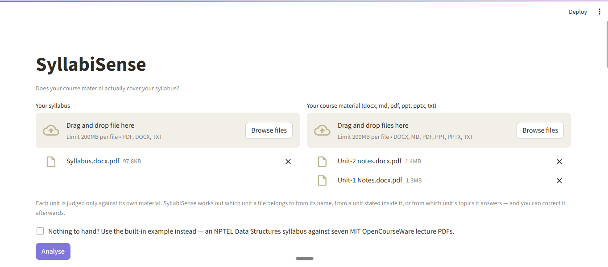
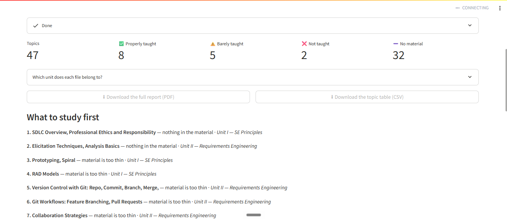
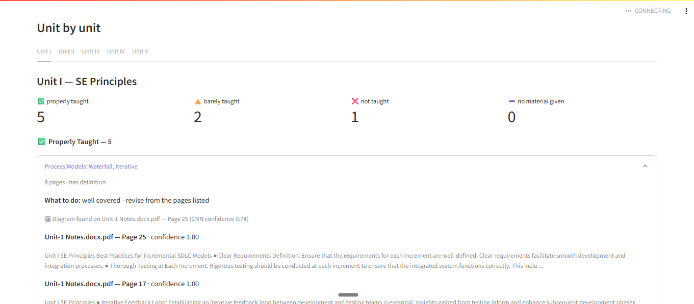

# SyllabiSense

**Does your course material actually cover your syllabus?** Upload a syllabus and a folder of
notes, and for every syllabus topic the system reports *properly taught / barely taught / not
taught*, citing the file and page as evidence.

A document chatbot cannot do this. It answers questions about the pages it is given, and can
never report that something is **missing**, because it never sees the syllabus. Detecting absence
means holding both documents at once and judging every pairing between them.

## Measured, not claimed

| Question | Accuracy | Baseline |
|---|---|---|
| Is this page evidence for this topic? | **83.1%** | — |
| Does my material cover this topic at all? | **79.3%** | 62% |
| Properly / barely / not taught? | 56.0% ±7.9 | 38% |

Measured against **450 items labelled by hand**, not against the automatic labels the models
trained on — those are only 84.6% correct, and scoring against them inflates the first row to
93.0%.

**When it says a topic is missing, it has never once been wrong** (100% precision on *not
covered*, n=150). The errors run the other way: it sometimes calls a topic covered when the page
only mentions it in passing. For a study aid that is the safe direction — a student is never sent
chasing material they already have.

    python demo.py

recomputes every figure above from the saved models. It reproduces the human-verified 83.1%
exactly, and the test figure to within 0.2 points.

## What makes the evaluation worth trusting

**The split is by subject area, never random.** Training uses 12 non-computing subjects;
Computer Science is held out entirely. A random split would put pages from the same course on
both sides and measure memorisation.

**The training labels were themselves audited.** 300 pairs were re-labelled by hand on a screen
that hides the automatic label. They proved 84.6% correct, so every headline number is reported
against the human labels too.

**Negative results are kept.** A fine-tuned transformer was trained as a comparison and lost
(80.1% against 83.1%), so it is not deployed. A 3-class depth model scores at chance (39.5% on 38
held-out topics, against a 38% baseline), so the application uses transparent rules instead. A
CNN trained from scratch reached 75.0% accuracy at 0.11 recall — it had learned to answer "no
diagram" almost always — so the shipped one uses transfer learning and reaches 0.72.

**An ablation says what the model actually uses.** Removing three hand-crafted similarity
features drops accuracy from 93.0% to 62.8%. That is why the transformer comparison matters: it
reaches comparable accuracy reading raw text, with no hand-crafted features at all.

## Known weaknesses

- **The three-way verdict is the weak part**, at 56% on 150 hand-labelled topics. It cannot yet
  tell a passing mention from real teaching — a page that names a topic inside another topic's
  explanation still counts as evidence.
- **Accuracy varies by subject** far more than any change made to the rules: the same rules score
  48% on one half of the subjects and 63% on the other. A single number hides that.
- **One annotator.** All 450 labels came from one person, so no inter-annotator agreement can be
  reported.
- **One held-out subject area.** Generalisation rests on a single sample, not cross-validation.
- **Tuning the rules did not help.** A grid search over the thresholds gained 1.2 points on
  held-out subjects — 0.55 standard errors, indistinguishable from chance. The ceiling is the
  features, not the thresholds.
- Diagram detection reads PDF pages only; slides and Word files are reported as *not checked*.
  Pages with no text layer are skipped, and the app names the files it could not read rather than
  silently returning nothing from them.

## What it does

Upload a syllabus and your course material (PDF, PowerPoint, Word). The system extracts the
syllabus topics, reads every page of the material, and decides which pages are evidence for which
topic. Topics with no evidence are reported as gaps.

Each unit is judged only against its own material. The unit a file belongs to is taken from its
name, from a unit stated inside it, or from which unit's topics it answers — and can be corrected
in the app. A unit with no material is reported as *no material provided*, not as *not taught*.

Below: a Software Engineering syllabus of 47 topics checked against the Unit 1 and Unit 2 notes
only. Three units had nothing uploaded, and the system says so rather than calling them gaps.

Every verdict cites the page it came from, with the model's confidence. Where a diagram exists,
the CNN says so.

A quiz can be built from the covered topics. The wrong answers are drawn from the topics nearest
in the project's own TF-IDF and LSA space, so they are near misses rather than obvious filler —
no language model is involved.

## The dataset was built for this

No suitable dataset existed. 7,133 PDFs and 100,414 pages were collected from NPTEL, MIT
OpenCourseWare and OpenStax and turned into **17,887 labelled (topic, page) pairs**: positives by
term proximity, hard negatives from the same course, easy negatives from an unrelated subject.
`docs/dataset_sources.md` lists every source. The PDFs themselves are not in this repository.

## Models

| Model | Question | Architecture | Deployed |
|---|---|---|---|
| Evidence ANN | is this page evidence for this topic? | 387 → 256 → 64 → 1, 115,841 parameters | yes |
| Diagram CNN | does this page contain a diagram? | MobileNetV2 base + trained head | yes |
| Cross-encoder | the same question, from raw text | MiniLM, 6 layers fine-tuned, 22.7M parameters | no — measured worse |
| Depth ANN | properly / barely / not taught | 16 → 64 → 32 → 3, softmax | no — loses to rules |

The evidence ANN runs in numpy at prediction time (`evidence.py`), matching the Keras model to
six decimal places. TensorFlow is optional: without it the application runs and omits the diagram
line. That took peak memory from 444 MB to 174 MB and removed a dependency that pins the Python
version.

## Run it

    pip install -r requirements.txt
    streamlit run app.py          # or double-click run_app.bat

Command line:

    python analyze.py --syllabus syllabus.pdf --material notes_folder --out report.md

## Training pipeline

    python build_dataset.py            # labelled (topic, page) pairs, split by subject
    python features_tfidf.py           # TF-IDF + LSA features
    python train_ann.py                # the feature-based ANN
    python train_crossencoder.py       # the fine-tuned transformer
    python evaluate_gold.py            # score against human labels

    python evaluate_gold_ce.py         # same, for the transformer (identical protocol)

    python build_depth_candidates.py   # topics + evidence + features
    streamlit run depth_review.py      # human depth labelling
    python train_depth.py              # the 3-class depth model

    python render_pages.py             # page images for the CNN
    streamlit run image_review.py      # human diagram labelling
    python train_cnn_scratch.py        # CNN from scratch (fails - kept for comparison)
    python train_cnn.py                # MobileNetV2 transfer learning

`review_tool.py` is the screen used to collect the human-verified relevance labels.

## Layout

    app.py analyze.py          run the system
    loaders.py                 PDF / PPTX / DOCX / TXT readers, one common shape
    syllabus_topics.py         syllabus parser (units and topics)
    units.py                   match material files to syllabus units
    depth.py                   evidence -> teaching depth
    match.py                   page-type filters and the matcher used to build the dataset
    models/                    trained models
    results/                   metrics, confusion matrices, graphs
    docs/                      proposal, example report, dataset details
    tools/                     scripts used to collect the dataset (not needed to run anything)

The dataset itself (5.5 GB) is not in the repo. `docs/dataset_sources.md` lists every source.
